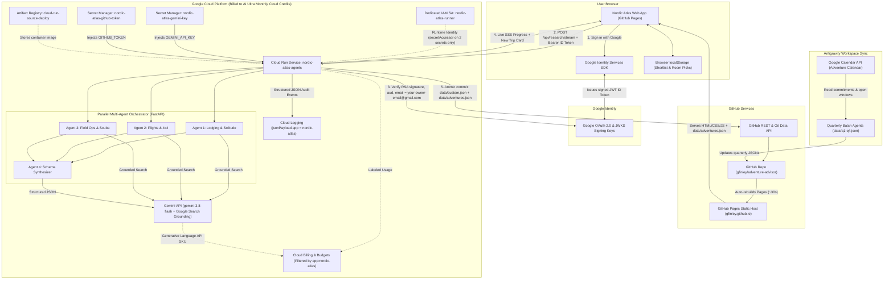
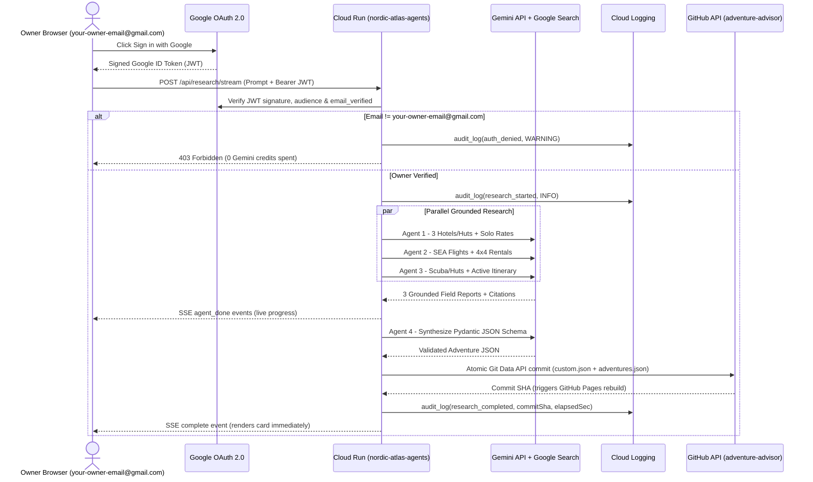

# Nordic Atlas — Service Architecture & GCP Governance Map

This document maps every external, GitHub, and Google Cloud Platform (GCP) service powering **Nordic Atlas**, how requests and secrets flow between your browser, backend agents, and repository, and how every GCP resource is uniformly tagged for cost tracking, auditing, and clean teardown.

---

## 1. End-to-End Service Interaction Map



---

## 2. Live Research Request Sequence (Auth -> Parallel Agents -> GitHub Auto-Save)



---

## 3. Complete Service Inventory & Security Boundaries

| Layer | Service | Purpose | Credentials / Auth | Cost Basis |
| --- | --- | --- | --- | --- |
| **Frontend Host** | GitHub Pages (`gfinley.github.io/adventure-advisor`) | Serves static HTML/CSS/JS, generated images, and `data/adventures.json` | Public read; writes restricted to repo owner / scoped PAT | \$0 (Free public repo) |
| **Identity** | Google Identity Services (OAuth 2.0 Web Client) | Issues signed JWT ID Token to verify `your-owner-email@gmail.com` | Public `GOOGLE_CLIENT_ID` restricted to `https://gfinley.github.io` | \$0 |
| **Compute** | Google Cloud Run (`nordic-atlas-agents`, `us-west1`) | Verifies JWT, runs 3 parallel agents + synthesizer, streams SSE, commits to GitHub | Runs as dedicated SA `nordic-atlas-runner`; enforces Bearer JWT on `/api/*` | Scales to 0 when idle (~\$0/mo; covered by AI Ultra Cloud credits) |
| **AI & Search** | Gemini API (`gemini-3.8-flash` + `google_search` grounding) | Live web search for hotels, 4x4 rates, flights, scuba/hut operators, and JSON synthesis | `GEMINI_API_KEY` injected from Secret Manager | Covered by AI Ultra monthly Cloud credits (\$40–\$100/mo) |
| **Secrets** | Google Secret Manager (`2` secrets) | Encrypted storage for `nordic-atlas-gemini-key` and `nordic-atlas-github-token` | Accessible ONLY by `nordic-atlas-runner` (`secretAccessor` per-secret IAM) | Pennies/month (free tier covers first 6 active secret versions) |
| **Container Registry** | Google Artifact Registry (`cloud-run-source-deploy`) | Stores Docker image built by Cloud Build during `./deploy.sh` | Managed by Cloud Build & Cloud Run | Free tier covers first 0.5 GB storage |
| **Audit Logs** | Google Cloud Logging | Captures structured JSON audit logs (`auth_success`, `auth_denied`, `research_completed`, `adventure_deleted`) | Automatic stdout ingestion from Cloud Run | Free tier covers first 50 GiB/month |
| **Repo Persistence** | GitHub Git Data API (`gfinley/adventure-advisor`) | Atomic commits updating `data/custom.json` + `data/adventures.json` | Fine-grained PAT scoped ONLY to 1 repo (`Contents: Read & Write`) | \$0 |
| **Calendar Sync** | Google Calendar (`Adventure Calendar`) | Source of truth for committed NOLS/training dates read during Antigravity planning | OAuth via Antigravity `gcalendar` plugin (not exposed to web app) | \$0 |

---

## 4. GCP Tagging, Auditing & Cost Governance Standard

Every GCP resource provisioned by [`backend/deploy.sh`](../backend/deploy.sh) carries a **uniform 7-key label taxonomy** so you can audit ownership, security boundaries, and billing in one filter:

| GCP Label Key | Value | Purpose |
| --- | --- | --- |
| `app` | `nordic-atlas` | Primary application identifier across all GCP consoles & Billing |
| `component` | `adventure-advisor-agents` | Isolates the multi-agent backend workload |
| `env` | `prod` | Environment separation (override via `APP_ENV=dev`) |
| `owner` | `gfinley` | Human owner for auditing |
| `cost-center` | `personal-travel-ai` | Billing rollup bucket for personal AI projects |
| `managed-by` | `deploy-sh` | Tracks IaC/script provenance |
| `repo` | `adventure-advisor` | Maps resource directly back to `gfinley/adventure-advisor` |
| `secret-purpose` *(secrets only)* | `gemini-api` / `github-repo-sync` | Identifies each secret's exact blast radius |

### Resources Tagged Automatically by `backend/deploy.sh`
- **Cloud Run Service:** `nordic-atlas-agents` (`--labels=...`)
- **Secret Manager Secrets:** `nordic-atlas-gemini-key` and `nordic-atlas-github-token` (`--labels=...`)
- **Artifact Registry Repository:** `cloud-run-source-deploy` (`--update-labels=...`)
- **Dedicated Runtime Service Account:** `nordic-atlas-runner@<PROJECT_ID>.iam.gserviceaccount.com` (never uses the broad default Compute Engine SA; bound ONLY to the 2 secrets above)
- **Structured Application Audit Logs:** Every JSON log record includes `"app": "nordic-atlas"`, `"component": "adventure-advisor-agents"`, `"env": "prod"`, `"owner": "gfinley"`

### One-Command Audit & Clean Teardown
Run [`backend/audit_and_cleanup.sh`](../backend/audit_and_cleanup.sh) anytime from Cloud Shell or your terminal:

```bash
export GCP_PROJECT_ID="your-gcp-project-id"

# Inspect all labeled Cloud Run services, secrets, IAM SA, Artifact Registry & last 15 audit events:
./backend/audit_and_cleanup.sh audit

# Cleanly delete Cloud Run service, both secrets, and the dedicated SA:
./backend/audit_and_cleanup.sh destroy
```

### Useful Cloud Logging & Billing Filters
- **All Nordic Atlas audit events (Cloud Logging):**
  ```text
  jsonPayload.app="nordic-atlas"
  ```
- **Rejected login attempts (Security Audit):**
  ```text
  jsonPayload.app="nordic-atlas" AND jsonPayload.event="auth_denied"
  ```
- **Completed AI research runs & GitHub commits:**
  ```text
  jsonPayload.app="nordic-atlas" AND jsonPayload.event="research_completed"
  ```
- **Cloud Billing Cost Breakdown:**
  - Filter by **Label:** `app:nordic-atlas` (captures Cloud Run, Secret Manager, Artifact Registry).
  - *Note on Gemini API SKU attribution:* API-key-billed Gemini calls appear under the **Generative Language API** service at the GCP project level rather than per-Cloud-Run-label. Keeping Nordic Atlas in a dedicated GCP project (or monitoring `Generative Language API` alongside label `app:nordic-atlas`) + setting a **\$25/month Cloud Billing Budget alert** gives 100% visibility against your monthly AI Ultra credits.
